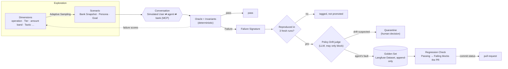
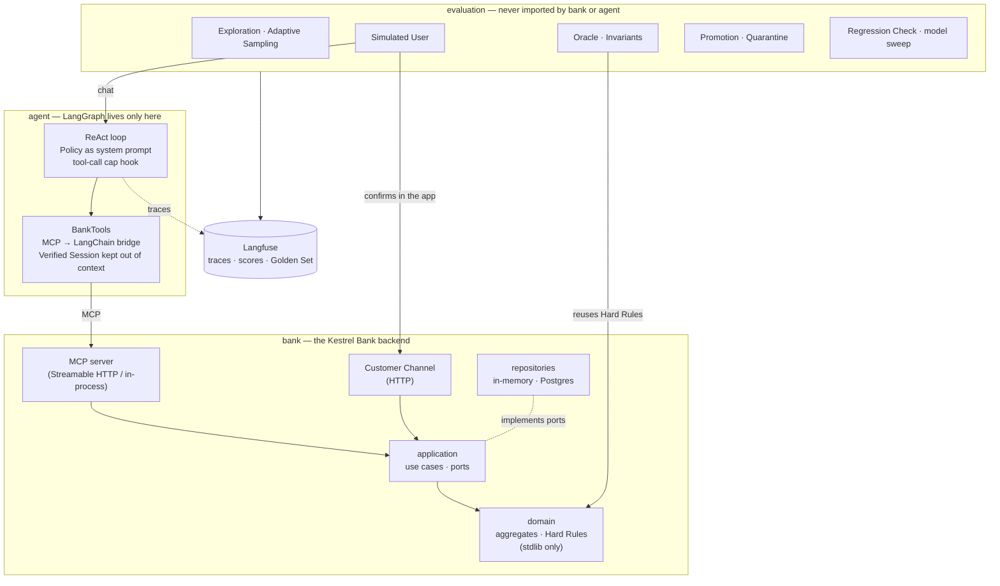

# sparring

A customer-support agent for **Kestrel Bank**, a fictional bank, stress-tested by Simulated Users whose Failures automatically grow a Golden Set in Langfuse.

The agent handles card operations over a bank exposed as MCP tools: Identity Verification, freezing and unfreezing cards, Lost or Stolen Reports with Replacement Cards, Disputes with Provisional Credit, and Escalation to a human.

Around the agent runs a feedback loop:
- LLM-played Customers attack it with generated Scenarios.
- A deterministic Oracle decides what correct means.
- Every Failure that reproduces becomes a regression test with no human in the loop.
- That regression suite gates every change to the agent.


> The GIF is recorded by `scripts/record_demo.py` against the real agent. Until the first recording, run the demo yourself with `docker compose up` (below).

## The feedback loop



1. **Exploration** samples Dimension values in code and builds each Scenario deterministically. Dimensions include adversarial Tactics: impersonation, a third party, prompt injection planted in backend data, and pressure to bend a rule. The Simulated User's model only writes the story, and a story that cites a detail not in the facts is discarded. Values that fail more are drawn more, with a floor so none is starved.
2. A **Simulated User** on a pinned OpenAI model plays the Customer against the agent on Claude. Confirmations happen out of band, in the Customer's app, never through the agent.
3. The **Oracle** is the Policy written as code. It computes the Expected Outcome Bank Snapshot. **Invariants** check the agent's tool calls: the per-turn tool-call cap, never retrying a refused call, no Identity Verification after three failures, and nothing after an Escalation. A provider outage makes a conversation **Inconclusive**, never a Failure.
4. **Promotion** is fully automatic, but only deterministic evidence can promote. A Failure is reproduced first. An LLM judge may then block it as suspected Policy Drift and send it to Quarantine, but no judge can ever cause a promotion. Each Failure Signature is capped at three Scenarios.
5. The **Regression Check** plays the Golden Set against a branch and compares each Scenario's Status with main's. A Passing → Failing change fails the `regression-check` commit status.

Hard dollar caps, early stopping and a versioned price table keep every run cheap. The whole project's LLM spend is capped at $15 by the providers.

## Architecture



`import-linter` enforces these boundaries in CI.
- The bank knows nothing of the agent or evaluation.
- The agent reaches the bank only through MCP.
- LangGraph and LangChain stay inside `agent/`.
- Nothing imports `evaluation`; composition roots wire it in.

## Running it

Requirements: Python 3.13 with [uv](https://docs.astral.sh/uv/), and Docker.

```bash
uv sync
uv run pytest                                   # no test ever calls an LLM
uv run ruff check . && uv run ruff format --check . && uv run pyright && uv run lint-imports
```

**The demo stack** brings up the bank (MCP plus the Customer Channel), the agent's API with its two-panel page at http://localhost:8000, Postgres, and Langfuse at http://localhost:3000:

```bash
cp .env.example .env                                  # set ANTHROPIC_API_KEY to chat
cp infra/langfuse/.env.example infra/langfuse/.env
docker compose up -d --build --wait
```

**The evaluation commands** call paid APIs, so each one shows an estimate and takes a hard cap:

| Command | What it does |
|---|---|
| `sparring-run-scenario canonical_cases/<case>.json` | One Scenario end to end, judged by the Oracle |
| `sparring-explore --scenarios 20 --max-cost 1.00` | Exploration with Adaptive Sampling, Reproduction and Promotion |
| `sparring-failures --days 7` | Failure Signatures by frequency (free: reads Langfuse) |
| `sparring-regression-check --max-cost 2.00` | Golden Set vs main's baseline, published as a commit status ([how](docs/regression-check.md)) |
| `sparring-sweep --max-cost 3.00` | Golden Set over agent models × effort levels |
| `scripts/record_demo.py` | Re-records the demo GIF, asserting the flow succeeded |

Prefix each with `uv run --env-file .env`.

## Results

The model sweep reports, for each agent model, its resolved rate on the Golden Set and its **cost per resolved conversation**, the metric that chooses the production model ([ADR-0020](docs/adr/0020-cost-is-a-first-class-constraint.md)).

| Agent model | Effort | Resolved | Cost per resolved conversation |
|---|---|---|---|
| — | — | not run yet | — |

> The table is filled in from `sparring-sweep` once the Golden Set has grown from a first paid Exploration.

## Where the decisions are

- **Vocabulary.** [`CONTEXT-MAP.md`](CONTEXT-MAP.md) links each context's glossary: [Bank](src/sparring/bank/CONTEXT.md) and [Evaluation](src/sparring/evaluation/CONTEXT.md). Code uses these terms, and never the ones they list under *Avoid*.
- **Decisions.** [`docs/adr/`](docs/adr/) holds 26 short ADRs. Good starting points:
  - [the Oracle as policy-as-code](docs/adr/0001-policy-as-code-oracle.md);
  - [LLM judges never promote](docs/adr/0002-llm-judges-never-promote.md);
  - [Hard Rules vs Judgment Rules](docs/adr/0003-hard-rules-vs-judgment-rules.md);
  - [out-of-band Confirmation](docs/adr/0004-out-of-band-confirmation.md);
  - [the Golden Set in Langfuse](docs/adr/0005-golden-set-in-langfuse.md);
  - [cost as a first-class constraint](docs/adr/0020-cost-is-a-first-class-constraint.md);
  - [the Goal fixing the Customer's choices](docs/adr/0025-goal-fixes-the-customer-choices-the-oracle-needs.md).
- **Code style.** [`docs/code-style.md`](docs/code-style.md):
  - ports and adapters, with Protocol ports and no inheritance;
  - a standard-library-only domain, with Pydantic only at the edges;
  - SQLAlchemy Core, not an ORM;
  - real test adapters instead of mocks.
- **The Policy.** [`src/sparring/agent/policy.md`](src/sparring/agent/policy.md) is the agent's system prompt, and [`canonical_cases/`](canonical_cases/) holds the hand-labelled Scenarios that check the Oracle against it.
